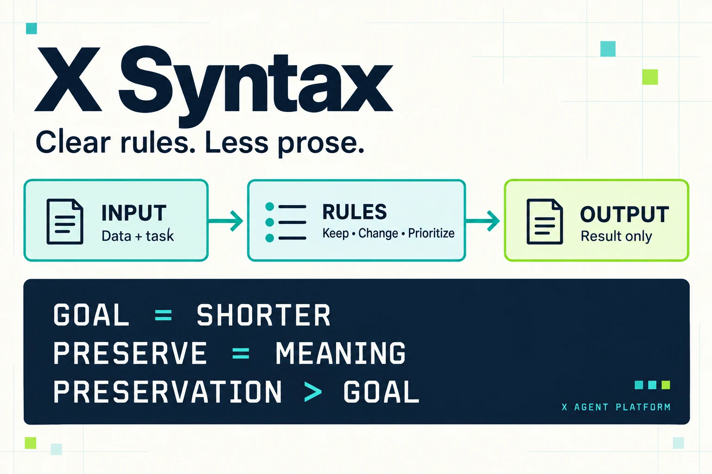
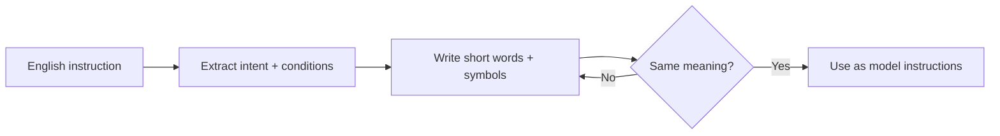
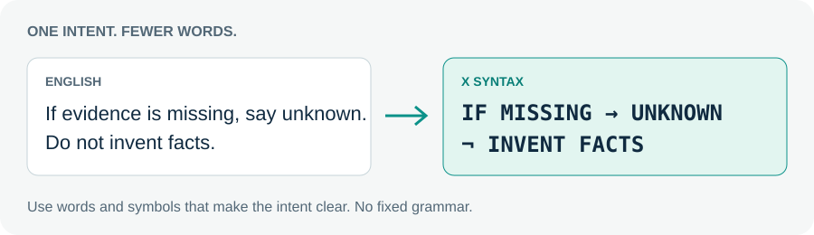

# X Syntax



**English intent. Symbolic instructions.**

X Syntax is the **X Agent platform's style of writing instructions for large language models**: turn ordinary English into compact pseudocode using simple uppercase words, symbols, and logic.

**No fixed grammar. No reserved keywords. No mandatory template.** It's a writing approach, not executable code.

## The spirit

- Keep the intent; lose the ceremony.
- Use short action words: `TOOL`, `JOIN`, `CHECK`, `KEEP`, `OUTPUT`.
- Express flow, conditions, and priorities instead of explaining them repeatedly.
- Invent useful labels. Prefer clarity over clever compression.
- Capitalize instructions—not the source text you're working with.

Symbols are tools, not a specification: `→` can show flow, `+` combine ideas, `IF` introduce a condition, `¬` exclude something, and `>` express priority.

## Before → after

### 1. Summarize

**English:** “Summarize the text in three bullets. Keep all numbers and important caveats.”

**X Syntax:**
```text
SUMMARIZE(TEXT) → 3 BULLETS
KEEP: ALL NUMBERS + IMPORTANT CAVEATS
```

### 2. Compare

**English:** “Compare the options using the supplied sources. Show cost and capacity in a table. Mark missing information as unknown; don't invent values.”

**X Syntax:**
```text
COMPARE(OPTIONS, SOURCES) → TABLE[COST, CAPACITY]
IF MISSING → UNKNOWN
¬ INVENT VALUES
```

### 3. Fix a bug

**English:** “Fix the bug with the smallest correct change. Preserve the public API and avoid unrelated changes. Run tests if available; report if they weren't run.”

**X Syntax:**
```text
FIX(BUG) → MIN CORRECT PATCH
KEEP: PUBLIC API; ¬ UNRELATED CHANGES
TEST IF AVAILABLE; IF NOT RUN → REPORT
```

[Copyable before/after pairs](examples/)

## How to write it





## Why use it?

Designed for compact prompts and explicit logic. The creator reports strong LLM performance and token savings in extensive prior benchmarking; those benchmark artifacts are not included here. Savings depend on the model and tokenizer—shorter text doesn't always mean fewer tokens.

Uppercase and symbols aren't compliance guarantees. Check important outputs.

[MIT license](LICENSE)
